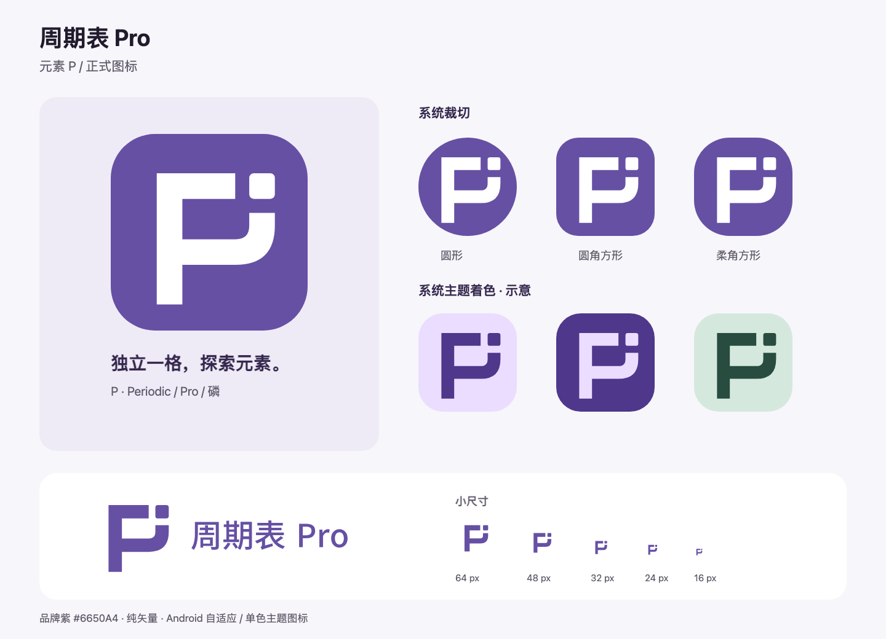

# 周期表 Pro · 元素 P 图标

用户于 2026-11-03 选定 B。P 的一角成为独立元素单元，关联 Periodic、Pro 与磷元素。造型不包含原子序号，适合小尺寸使用。

## 文件与使用

| 文件 | 用途 |
|---|---|
| `masters/periodic-pro-symbol.svg` | 紫色符号母版，透明底 |
| `masters/periodic-pro-symbol-small.svg` | ≤32px 符号；两处间隙由 16 加宽至 20 单位 |
| `masters/periodic-pro-symbol-reversed.svg` | 反白；笔画由 32 减至 31 单位，减少视觉膨胀 |
| `masters/periodic-pro-horizontal.svg` / `periodic-pro-stacked.svg` | 横式 / 竖式组合，文字均已转曲 |
| `masters/periodic-pro-wordmark.svg` | 独立名称字标 |
| `masters/periodic-pro-app-icon.svg` | 圆角方形预览，配套 `periodic-pro-app-1024.png` |
| `masters/periodic-pro-play-icon.svg` | 满底直角商店母版，配套 `periodic-pro-play-512.png` |
| `variants/` | 黑色、品牌单色、横竖组合黑色与反白导出 |
| `web/` | favicon（SVG / ICO / 16、32、48px）、180 / 192 / 512px 图标、maskable 图标及 manifest 示例 |
| `ic_launcher_*.xml` | Android 前景、背景、monochrome 的交付副本，与应用 drawable 保持一致 |
| `preview.png` | 按 Android 实际前景路径制作的裁切、主题着色与小尺寸预览 |
| `presentation.html` / `presentation/` | 本地场景展示及逐页 PNG；情境示意，不代表产品界面已改动 |
| `guidelines.html` | 单页使用规范，可浏览或打印 |

## 配色与字标

| 颜色 | HEX | RGB | CMYK（近似，需打样） |
|---|---|---|---|
| 品牌紫 | `#6650A4` | 102 / 80 / 164 | 38 / 51 / 0 / 36 |
| 白 | `#FFFFFF` | 255 / 255 / 255 | 0 / 0 / 0 / 0 |
| 黑色版本 | `#000000` | 0 / 0 / 0 | 0 / 0 / 0 / 100 |

品牌紫与白对比约 6.46:1。Pantone 未指定，本次为数字图标交付；印刷时由印厂依据实际材质打样匹配，勿将屏幕值当作色卡承诺。

名称使用 **Noto Sans CJK SC Medium**，SIL OFL 1.1，所有交付 SVG 已转为路径，不依赖用户安装字体，未附字体文件。来源：[Noto CJK 官方仓库](https://github.com/notofonts/noto-cjk)，[字体许可](https://github.com/notofonts/noto-cjk/blob/main/Sans/LICENSE)。P 符号为单独构造的几何路径。

## 留白、最小尺寸与禁用

- 以主笔画宽 `u = 32` 为单位；独立符号周围保留至少 `1u` 的外部留白。应用容器按专用图标母版使用。
- 符号最小 16px；≤32px 使用 small 版本。横式组合建议最小 160px 宽，竖式组合最小 128px 宽；更小时只用符号。
- 白底使用紫色或黑色；紫底/深底使用反白。深底勿直接放品牌紫，复杂图片上先放纯色承载面。
- 勿拉伸、旋转、填上间隙、加入数字/渐变/发光/描边；不要把独立方块移作通知圆点。
- 主符号有意做光学校正（向右、下各 8 单位）；不要依据包围盒重新居中。

## Android 接入

- `app/src/main/res/mipmap-anydpi-v26/ic_launcher.xml` 继续引用 foreground、background 与 monochrome。
- 前景 / 单色：108dp 全画布，256 单位路径缩放 `0.302`、平移 `15.344`；轮廓与控制点位于中心 66dp 直径安全圆内。背景满底，系统自行裁切。
- 普通图标浅深色均为紫底白标；删除旧 `drawable-night` 图标覆盖，避免切到旧的 P+15。
- Android 7.x（API24–25）使用新增的 `mipmap-anydpi/ic_launcher.xml` 矢量回退。
- monochrome 只有符号，无背景；最终主题色由设备壁纸与启动器决定，预览配色仅为示意。
- 商店图标是 512×512 sRGB RGBA PNG，完全不透明，直角满底，无外部阴影；不要上传带圆角透明边的预览图。

规范依据：[Android adaptive icons](https://developer.android.com/develop/ui/compose/system/icon_design_adaptive)、[Google Play icon specifications](https://developer.android.com/distribute/google-play/resources/icon-design-specifications)。网页图标 manifest 以站点根目录为部署示例，不会发布网站。

## 验证与边界

SVG 无位图、字体依赖、滤镜或描边；已渲染检查小尺寸、单色/反白、镜像与旋转。Android 安全区与资源同步使用断言检查。`:app:processDebugResources`、`:app:assembleDebug` 与 `:app:lintDebug` 通过；Lint 为 0 错误、79 条现存警告（未出现图标资源告警）。

全量单测受已有 `DetailViewModelTest.kt:78/92/109/118` 的构造参数不匹配阻塞；对应生产类与测试均未被本次修改。项目未配置 detekt，未新增依赖或检查插件。

未进行商标数据库或全网反向图片检索；上线前建议按目标市场完成专业检索。未将当前开发版本安装到连接的个人设备，裁切与主题预览属于静态验证。
